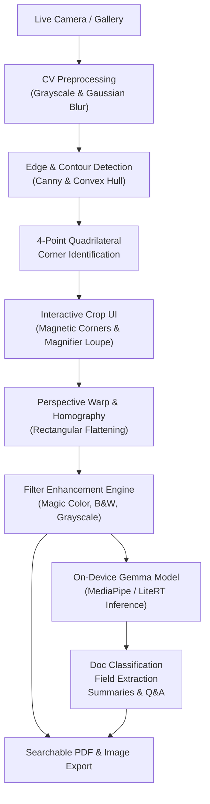

# CamScanner Local AI (Gemma Edition)

[](https://flutter.dev)
[](https://dart.dev)
[-4285F4?logo=google&logoColor=white)](https://ai.google.dev/gemma)
[](LICENSE)

A high-fidelity, privacy-first mobile document scanner and on-device document intelligence tool. Built with Flutter, native computer vision, and local AI (Google Gemma / PaliGemma via MediaPipe / LiteRT). 

**100% Offline. Zero Third-Party Services. Zero Cloud Uploads.**

---

## 🎯 Key Features

1. **Intelligent Edge & Contour Detection**
   - Automated detection of document boundaries using multi-stage Canny edge detection, gradient analysis, and contour approximation.
   - Interactive 4-point magnetic corner adjustment with high-magnification touch loupe for pixel-precise corner alignment.

2. **Perspective Dewarping & Color Enhancement**
   - Mathematical homography perspective warp flattening skewed documents into crisp planar sheets.
   - Professional scan filters:
     - **Magic Color**: CamScanner-style adaptive local contrast, shadow removal, and ink pop.
     - **High-Contrast B&W**: Optimized for text readability, forms, and photocopying.
     - **Grayscale**: Multi-tone document reproduction.
     - **Lighten**: Suppresses background tint and paper creases.

3. **100% On-Device Intelligence with Gemma**
   - **Zero Cloud Requirement**: Models execute entirely on the phone's NPU/GPU using MediaPipe GenAI / LiteRT.
   - **Document Classification**: Instantly detects Invoices, Receipts, Contracts, IDs, Business Cards, and Handwritten Notes.
   - **Structured Field Extraction**: Local extraction of key metadata (vendor, dates, monetary amounts, tables) to structured JSON.
   - **Document Q&A & Summarization**: Offline conversational assistant for contracts, receipts, and study notes.
   - **Searchable PDF**: Embedding invisible OCR text layers into generated PDFs for native text selection and copying.

4. **Multi-Page Management & Export**
   - Multi-page batch document scanning.
   - Drag-and-drop page reordering, individual page rotation, and re-processing.
   - Fast offline PDF generation with configurable compression levels.

---

## 📐 Architecture Overview



---

## 🚀 Getting Started

### Prerequisites
- **Flutter SDK**: `>= 3.41.0`
- **Dart SDK**: `>= 3.11.0`
- **Android SDK**: API level 35+ / Java 17+
- **Host Platforms Supported**: Android, iOS, Linux Desktop

### Setup & Run
```bash
# Clone the repository
git clone https://github.com/your-username/cam_scan.git
cd cam_scan

# Fetch dependencies
flutter pub get

# Run on connected device or emulator
flutter run
```

---

## 🔒 Privacy & Security

Your documents never leave your device. All image transformations, optical character recognition, and neural network inference (Gemma) run exclusively in your device's memory. No tracking, telemetry, or external network requests are made.

---

## 📄 License
MIT License. Free and open source.
