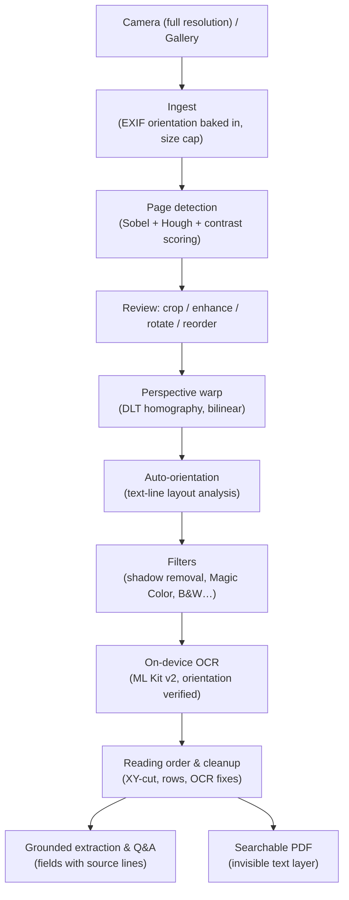

# ClearScan — Local AI Document Scanner

<div align="center">
  
  <h3>ClearScan: Zero-Cloud, 100% On-Device Document Scanner</h3>
  <p><strong>Private by Design. On-Device OCR. No Third Parties.</strong></p>

  [](https://flutter.dev)
  [](https://dart.dev)
  [](https://developers.google.com/ml-kit/vision/text-recognition/v2)
  [](#-privacy--security)
</div>

---

## 🚀 Overview

**ClearScan** is a mobile document scanner that turns photos of paper into clean, multi-page, searchable documents, and extracts their text and key fields, entirely on the phone. Image processing is pure Dart; text recognition uses Google ML Kit's bundled on-device model.

**100% Offline. Zero Third-Party Services. Zero Cloud Uploads.**

---

## 🎯 Key Features

1. **Automatic page detection**
   - Finds the page on cluttered desks with Sobel edges + a Hough transform, scoring every candidate quadrilateral by edge support and paper/background contrast. Close-ups resolve to the full frame.
   - Interactive 4-corner adjustment with a magnifier loupe; folded (non-convex) crops are prevented.

2. **Automatic orientation**
   - Sideways and upside-down pages (e.g. landscape sheets photographed in portrait) are turned upright automatically, using text-line layout analysis, verified by OCR when unsure.

3. **Perspective correction & enhancement**
   - Homography (DLT) warp with bilinear resampling up to 3000 px (~300 DPI for A4).
   - Filters built on shadow removal (illumination normalization):
     - **Magic Color**: white paper, black text, preserved stamps and signatures, adaptive to each page's ink and paper levels.
     - **B&W**: adaptive (Bradley) thresholding that keeps text readable in shadows.
     - **Grayscale** and **Lighten**.

4. **Multi-page documents**
   - Multi-page camera mode and multi-image import create one document with all pages.
   - Review screen: per-page crop, enhance, rotate and delete; drag to reorder; add more pages from camera or gallery, also for existing documents.

5. **On-device text recognition (OCR)**
   - Google ML Kit Text Recognition v2 (Latin scripts: French, English, Spanish, German…), with the model bundled in the app.
   - Full-resolution capture, layout-aware reading order (columns, tables, receipts keep "label   amount" on one row), hyphenation and common OCR confusions repaired (`1O0,00` → `100,00`, `I'entreprise` → `l'entreprise`).

6. **Grounded document insights**
   - Classification (invoice, receipt, contract, course/exercise sheet, ID, bank statement, …) in English and French.
   - Field extraction that **only reports values printed next to a clear label** ("Total TTC", "Facture N°", "Date d'échéance", …). Each field shows the source line it came from; documents without a total never get one.
   - Totals cross-checked (subtotal + VAT + stamp duty = total), IBANs validated with their checksum, three-decimal currencies (TND) handled.
   - Q&A that quotes the document or says the information is not there.

7. **Searchable PDF export**: page images with an invisible OCR text layer, so the PDF can be searched and text selected.

8. **Responsive UI**: light (default), dark or system theme, remembered between launches; long-press documents to select and delete several at once; phones to tablets (side-by-side insights on wide screens), tested against layout overflow at large font sizes.

---

## 📐 Architecture Overview



| Folder | Contents |
| :--- | :--- |
| `lib/core/cv` | Page detection, warp, orientation, filters, ingestion, isolate entry points |
| `lib/core/ocr` | OCR engine (ML Kit), OCR service, layout reconstruction |
| `lib/core/analysis` | Grounded field extraction, money parsing, document Q&A |
| `lib/core/storage` | Document repository (atomic, change-notifying), PDF export |
| `lib/ui` | Screens: home, camera, scan review, crop, enhance, document, insights |

---

## 📱 Build & Installation Guide (Android & iOS)

### Prerequisites

| Tool | Minimum Version | Note |
| :--- | :--- | :--- |
| **Flutter SDK** | `>= 3.41.0` | Stable channel |
| **Dart SDK** | `>= 3.11.0` | Included with Flutter |
| **Java JDK** | `17` or `21` | Configured via `JAVA_HOME` or `flutter config --jdk-dir` |
| **Android SDK** | API 35 (`android-35` / build-tools `35.0.0`) | Required for Android build |
| **Xcode** | `>= 15.0` | Required for iOS build (macOS host only) |
| **CocoaPods** | `>= 1.14.0` | Required for iOS native pod integration |

```bash
# Clone the repository
git clone https://github.com/Ahmed1-Rebai/ClearScan.git
cd ClearScan

# Fetch all dependencies
flutter pub get

# Run test suite to verify algorithms
flutter test
```

---

### 🤖 Android Setup & Installation

#### Option 1: Run directly on your connected Android phone (Debug Mode)
1. Enable **Developer Options** on your Android phone (Go to *Settings > About Phone*, tap *Build Number* 7 times).
2. Enable **USB Debugging** under *Settings > System > Developer Options*.
3. Connect your phone to your PC via USB and verify connection:
   ```bash
   adb devices
   ```
4. Run the app:
   ```bash
   flutter run -d android
   ```

#### Option 2: Build and Install Release APK
1. Compile the optimized standalone APK:
   ```bash
   flutter build apk --release
   ```
   *Output file location:* `build/app/outputs/flutter-apk/app-release.apk`

2. Sideload the APK onto your connected phone directly using ADB:
   ```bash
   adb install -r build/app/outputs/flutter-apk/app-release.apk
   ```
   *Or transfer `app-release.apk` to your phone via USB/WhatsApp/Drive and tap to install.*

#### Option 3: Build Android App Bundle (for Google Play Store)
```bash
flutter build appbundle --release
```
*Output file location:* `build/app/outputs/bundle/release/app-release.aab`

---

### 🍏 iOS Setup & Installation

> [!NOTE]
> Building and signing for iOS requires a computer running **macOS** with **Xcode** installed.

#### Option 1: Run on an iPhone via USB / Wi-Fi
1. Navigate to the `ios` directory and install CocoaPods dependencies:
   ```bash
   cd ios && pod install && cd ..
   ```
2. Open the iOS project in Xcode:
   ```bash
   open ios/Runner.xcworkspace
   ```
3. In Xcode:
   - Select the **Runner** project in the left sidebar.
   - Navigate to **Signing & Capabilities**.
   - Under **Team**, select your Apple ID / Developer Team (Free Apple IDs are fully supported for personal sideloading).
   - Set a unique **Bundle Identifier** (e.g., `com.yourname.clearscan`).
4. Connect your iPhone via USB, trust the computer, and enable **Developer Mode** on your iPhone (*Settings > Privacy & Security > Developer Mode*).
5. Run the app:
   ```bash
   flutter run -d ios
   ```

#### Option 2: Build an iOS Release Archive (.ipa)
1. Build the release bundle:
   ```bash
   flutter build ipa --release
   ```
   *To build without an active developer certificate (for sideloading via AltStore, Sideloadly, or TrollStore):*
   ```bash
   flutter build ipa --no-codesign
   ```
   *Output location:* `build/ios/archive/Runner.xcarchive` or `build/ios/ipa/ClearScan.ipa`.

2. Distribute via Xcode:
   - In Xcode, go to **Window > Organizer**.
   - Select your build and click **Distribute App** to upload to **TestFlight** or export as an enterprise/ad-hoc `.ipa`.

---

### 📦 Smaller APKs

The default APK bundles every CPU architecture. For sideloading, build one APK per architecture (most phones use `arm64-v8a`):

```bash
flutter build apk --release --split-per-abi
```

### 🍏 iOS notes

ML Kit requires **iOS 15.5+** (already set in the Xcode project) and a physical arm64 device.

---

## 🧪 Tests

```bash
flutter test
```

The suite covers extraction grounding (no invented fields), money/date parsing, layout reconstruction, page detection, orientation, filters, the OCR pipeline with a fake engine, storage, and layout-overflow checks of every screen at 320–1280 px widths with text scaled up to 2×.

---

## 🧠 About on-device language models

Field extraction and Q&A currently use a deterministic, grounded rule engine: every value is copied from a labeled line of the OCR text. A local LLM (e.g. Gemma via MediaPipe) is **not** bundled. If one is added later, its answers should go through the same grounding check (values must appear in the OCR text) before being shown.

---

## 🔒 Privacy & Security

Your documents never leave your device. Image processing, text recognition (bundled ML Kit model) and field extraction run in the app's memory and storage. Release builds on Android **do not request the network permission at all**, so nothing (including SDK usage statistics) can be sent from the phone.

---

## 📄 License
MIT License. Free and open source.

