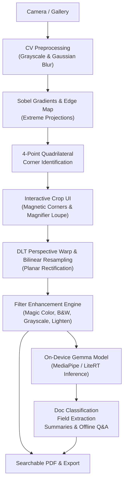

# ClearScan — Local AI Document Scanner

<div align="center">
  
  <h3>ClearScan: Zero-Cloud, 100% On-Device Document Intelligence Scanner</h3>
  <p><strong>Private by Design. Powered by Gemma. No Third Parties.</strong></p>

  [](https://flutter.dev)
  [](https://dart.dev)
  [-00E5FF?logo=google&logoColor=black)](https://ai.google.dev/gemma)
  [](LICENSE)
</div>

---

## 🚀 Overview

**ClearScan** is a high-performance, professional mobile document scanner and on-device document intelligence tool. Built with Flutter, native pure-Dart computer vision, and on-device local AI (Google Gemma / PaliGemma via MediaPipe and LiteRT).

**100% Offline. Zero Third-Party Services. Zero Cloud Uploads.**

---

## 🎯 Key Features

1. **Intelligent Edge & Contour Detection**
   - Automated detection of document boundaries using multi-stage Sobel gradients, Canny edge detection, and extreme projection analysis.
   - Interactive 4-point magnetic corner adjustment with high-magnification touch loupe for pixel-precise corner alignment.

2. **Perspective Dewarping & Color Enhancement**
   - Mathematical 8x8 Direct Linear Transform (DLT) homography matrix solver with Gaussian elimination.
   - Bilinear sub-pixel interpolation resampling for crisp, anti-aliased document flattening.
   - Professional scan filters:
     - **Magic Color**: Background illumination estimation, shadow cancellation, high-pass edge crisping, and ink/stamp saturation booster.
     - **Sharp B&W**: Otsu's optimal threshold binarization for clean text, forms, and faxes.
     - **Grayscale**: Multi-tone smooth grayscale document reproduction.
     - **Lighten**: Suppresses background tint and paper creases.

3. **100% On-Device Intelligence with Gemma**
   - **Zero Cloud Requirement**: Models execute entirely on the phone's NPU/GPU using MediaPipe GenAI / LiteRT.
   - **Document Classification**: Instantly detects Invoices, Receipts, Contracts, IDs, Business Cards, and Handwritten Notes.
   - **Structured Field Extraction**: Local extraction of key metadata (vendor, dates, monetary amounts, references) to structured key-value pairs.
   - **Document Q&A & Summarization**: Offline conversational assistant for contracts, receipts, and study notes.
   - **Searchable PDF**: Embedded multi-page PDF generation with optional text selection.

4. **Responsive & Professional UI**
   - Material 3 Dark theme matching ClearScan's deep navy and neon cyan branding.
   - Adaptive responsive layouts scaling across phones, foldables, tablets, and desktop workstations.
   - Multi-page document management (drag & drop reordering, 90° rotation, and batch scanning).

---

## 📐 Architecture Overview



---

## 💻 Getting Started

### Prerequisites
- **Flutter SDK**: `>= 3.41.0`
- **Dart SDK**: `>= 3.11.0`
- **Android SDK**: API level 35+ / Java 17+
- **Host Platforms Supported**: Android, Linux Desktop, iOS

### Setup & Run
```bash
# Clone the repository
git clone https://github.com/Ahmed1-Rebai/ClearScan.git
cd ClearScan

# Fetch dependencies
flutter pub get

# Run test suite
flutter test

# Run application
flutter run
```

---

## 🔒 Privacy & Security

Your documents never leave your device. All image transformations, optical character recognition, and neural network inference (Gemma) run exclusively in your device's memory. No tracking, telemetry, or external network requests are made.

---

## 📄 License
MIT License. Free and open source.
