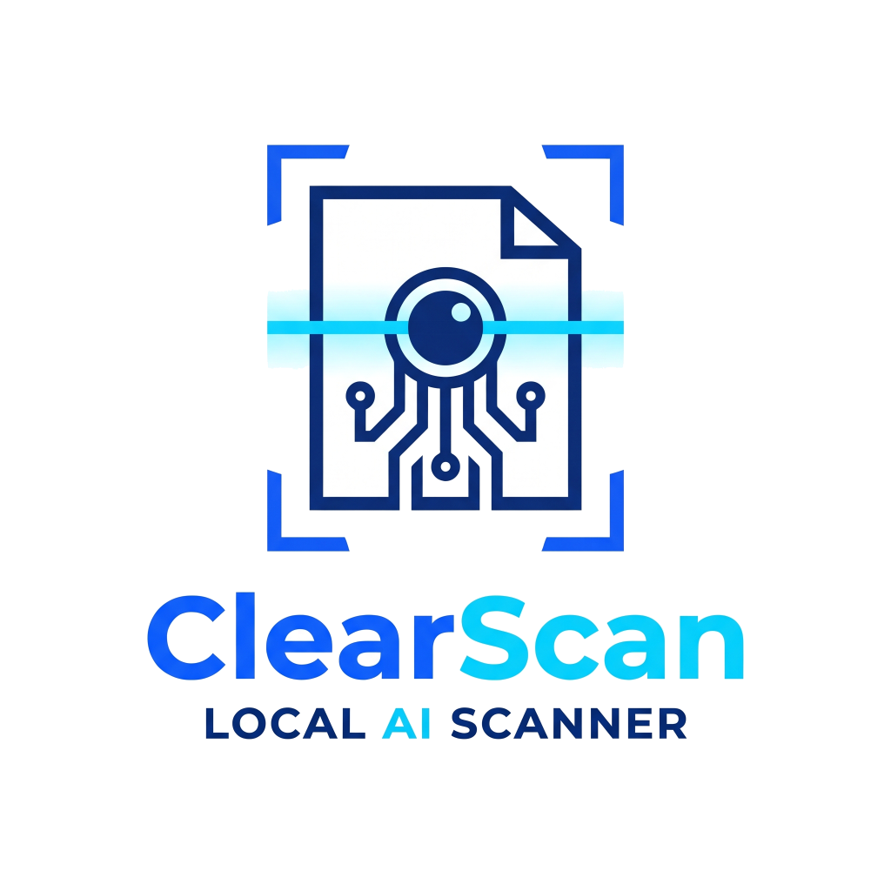
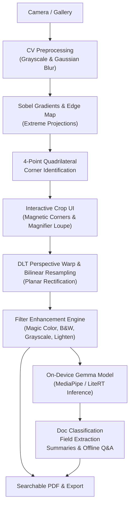

# ClearScan — Local AI Document Scanner

<div align="center">
  
  <h3>ClearScan: Zero-Cloud, 100% On-Device Document Intelligence Scanner</h3>
  <p><strong>Private by Design. Powered by Gemma. No Third Parties.</strong></p>

  [](https://flutter.dev)
  [](https://dart.dev)
  [-00E5FF?logo=google&logoColor=black)](https://ai.google.dev/gemma)
  [](LICENSE)
</div>

---

## 🚀 Overview

**ClearScan** is a high-performance, professional mobile document scanner and on-device document intelligence tool. Built with Flutter, native pure-Dart computer vision, and on-device local AI (Google Gemma / PaliGemma via MediaPipe and LiteRT).

**100% Offline. Zero Third-Party Services. Zero Cloud Uploads.**

---

## 🎯 Key Features

1. **Intelligent Edge & Contour Detection**
   - Automated detection of document boundaries using multi-stage Sobel gradients, Canny edge detection, and extreme projection analysis.
   - Interactive 4-point magnetic corner adjustment with high-magnification touch loupe for pixel-precise corner alignment.

2. **Perspective Dewarping & Color Enhancement**
   - Mathematical 8x8 Direct Linear Transform (DLT) homography matrix solver with Gaussian elimination.
   - Bilinear sub-pixel interpolation resampling for crisp, anti-aliased document flattening.
   - Professional scan filters:
     - **Magic Color**: Background illumination estimation, shadow cancellation, high-pass edge crisping, and ink/stamp saturation booster.
     - **Sharp B&W**: Otsu's optimal threshold binarization for clean text, forms, and faxes.
     - **Grayscale**: Multi-tone smooth grayscale document reproduction.
     - **Lighten**: Suppresses background tint and paper creases.

3. **100% On-Device Intelligence with Gemma**
   - **Zero Cloud Requirement**: Models execute entirely on the phone's NPU/GPU using MediaPipe GenAI / LiteRT.
   - **Document Classification**: Instantly detects Invoices, Receipts, Contracts, IDs, Business Cards, and Handwritten Notes.
   - **Structured Field Extraction**: Local extraction of key metadata (vendor, dates, monetary amounts, references) to structured key-value pairs.
   - **Document Q&A & Summarization**: Offline conversational assistant for contracts, receipts, and study notes.
   - **Searchable PDF**: Embedded multi-page PDF generation with optional text selection.

4. **Responsive & Professional UI**
   - Material 3 Dark theme matching ClearScan's deep navy and neon cyan branding.
   - Adaptive responsive layouts scaling across phones, foldables, tablets, and desktop workstations.
   - Multi-page document management (drag & drop reordering, 90° rotation, and batch scanning).

---

## 📐 Architecture Overview



---

## 📱 Build & Installation Guide (Android & iOS)

### Prerequisites

| Tool | Minimum Version | Note |
| :--- | :--- | :--- |
| **Flutter SDK** | `>= 3.41.0` | Stable channel |
| **Dart SDK** | `>= 3.11.0` | Included with Flutter |
| **Java JDK** | `17` or `21` | Configured via `JAVA_HOME` or `flutter config --jdk-dir` |
| **Android SDK** | API 35 (`android-35` / build-tools `35.0.0`) | Required for Android build |
| **Xcode** | `>= 15.0` | Required for iOS build (macOS host only) |
| **CocoaPods** | `>= 1.14.0` | Required for iOS native pod integration |

```bash
# Clone the repository
git clone https://github.com/Ahmed1-Rebai/ClearScan.git
cd ClearScan

# Fetch all dependencies
flutter pub get

# Run test suite to verify algorithms
flutter test
```

---

### 🤖 Android Setup & Installation

#### Option 1: Run directly on your connected Android phone (Debug Mode)
1. Enable **Developer Options** on your Android phone (Go to *Settings > About Phone*, tap *Build Number* 7 times).
2. Enable **USB Debugging** under *Settings > System > Developer Options*.
3. Connect your phone to your PC via USB and verify connection:
   ```bash
   adb devices
   ```
4. Run the app:
   ```bash
   flutter run -d android
   ```

#### Option 2: Build and Install Release APK
1. Compile the optimized standalone APK:
   ```bash
   flutter build apk --release
   ```
   *Output file location:* `build/app/outputs/flutter-apk/app-release.apk`

2. Sideload the APK onto your connected phone directly using ADB:
   ```bash
   adb install -r build/app/outputs/flutter-apk/app-release.apk
   ```
   *Or transfer `app-release.apk` to your phone via USB/WhatsApp/Drive and tap to install.*

#### Option 3: Build Android App Bundle (for Google Play Store)
```bash
flutter build appbundle --release
```
*Output file location:* `build/app/outputs/bundle/release/app-release.aab`

---

### 🍏 iOS Setup & Installation

> [!NOTE]
> Building and signing for iOS requires a computer running **macOS** with **Xcode** installed.

#### Option 1: Run on an iPhone via USB / Wi-Fi
1. Navigate to the `ios` directory and install CocoaPods dependencies:
   ```bash
   cd ios && pod install && cd ..
   ```
2. Open the iOS project in Xcode:
   ```bash
   open ios/Runner.xcworkspace
   ```
3. In Xcode:
   - Select the **Runner** project in the left sidebar.
   - Navigate to **Signing & Capabilities**.
   - Under **Team**, select your Apple ID / Developer Team (Free Apple IDs are fully supported for personal sideloading).
   - Set a unique **Bundle Identifier** (e.g., `com.yourname.clearscan`).
4. Connect your iPhone via USB, trust the computer, and enable **Developer Mode** on your iPhone (*Settings > Privacy & Security > Developer Mode*).
5. Run the app:
   ```bash
   flutter run -d ios
   ```

#### Option 2: Build an iOS Release Archive (.ipa)
1. Build the release bundle:
   ```bash
   flutter build ipa --release
   ```
   *To build without an active developer certificate (for sideloading via AltStore, Sideloadly, or TrollStore):*
   ```bash
   flutter build ipa --no-codesign
   ```
   *Output location:* `build/ios/archive/Runner.xcarchive` or `build/ios/ipa/ClearScan.ipa`.

2. Distribute via Xcode:
   - In Xcode, go to **Window > Organizer**.
   - Select your build and click **Distribute App** to upload to **TestFlight** or export as an enterprise/ad-hoc `.ipa`.

---

### 🧠 On-Device Gemma Model Installation (Optional)

ClearScan includes an integrated, zero-latency on-device heuristic document analyzer that works immediately out-of-the-box without extra downloads. 

To activate the full **Gemma 2B / PaliGemma NPU/GPU neural engine** on your phone:
1. Download the quantized model file:
   - **Gemma 2B INT4** (`gemma-2b-it-gpu-int4.bin` ~1.4 GB) from [Kaggle / Hugging Face](https://huggingface.co/google/gemma-2b-it).
2. Place the file inside the app's local storage directory:
   - **Android**: `/sdcard/Android/data/com.camscan.local/files/models/gemma-2b-it-gpu-int4.bin`
   - **iOS**: Documents folder inside ClearScan's sandbox (`models/gemma-2b-it-gpu-int4.bin`).
3. ClearScan will automatically detect the weights and initialize hardware-accelerated on-device inference via LiteRT/MediaPipe.

---

## 🔒 Privacy & Security

Your documents never leave your device. All image transformations, optical character recognition, and neural network inference (Gemma) run exclusively in your device's memory. No tracking, telemetry, or external network requests are made.

---

## 📄 License
MIT License. Free and open source.
